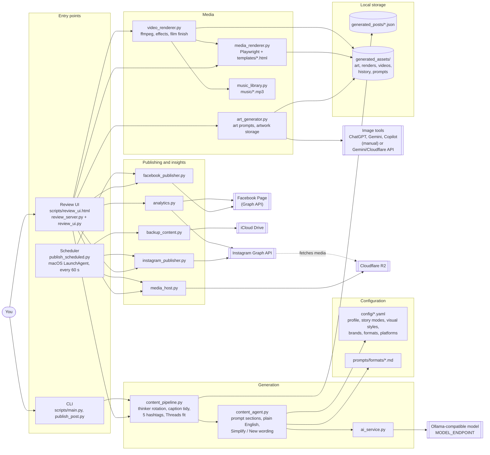
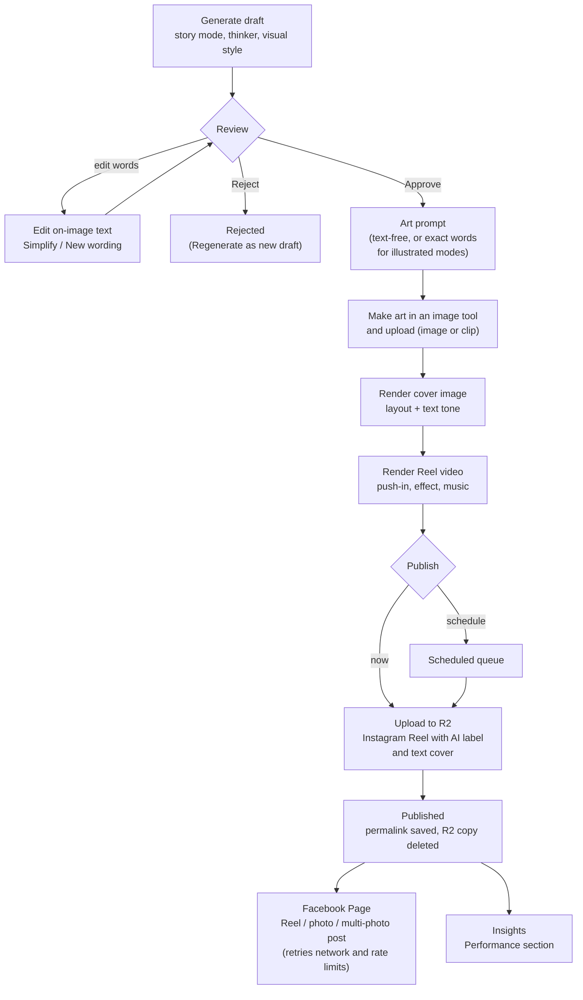
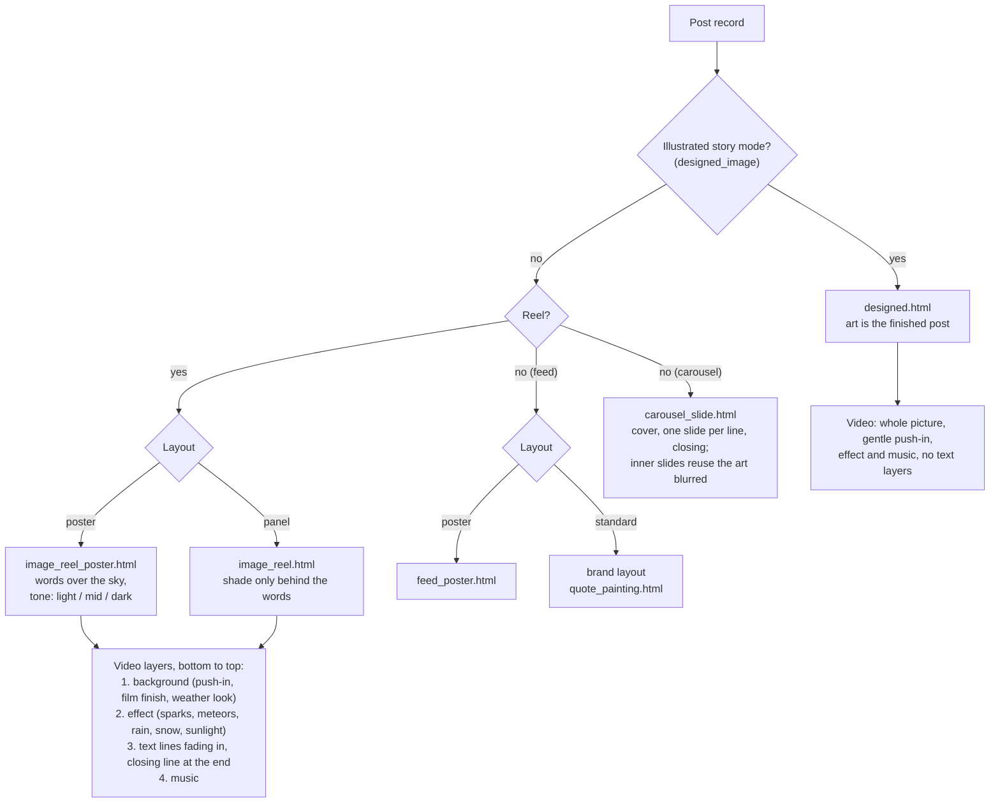
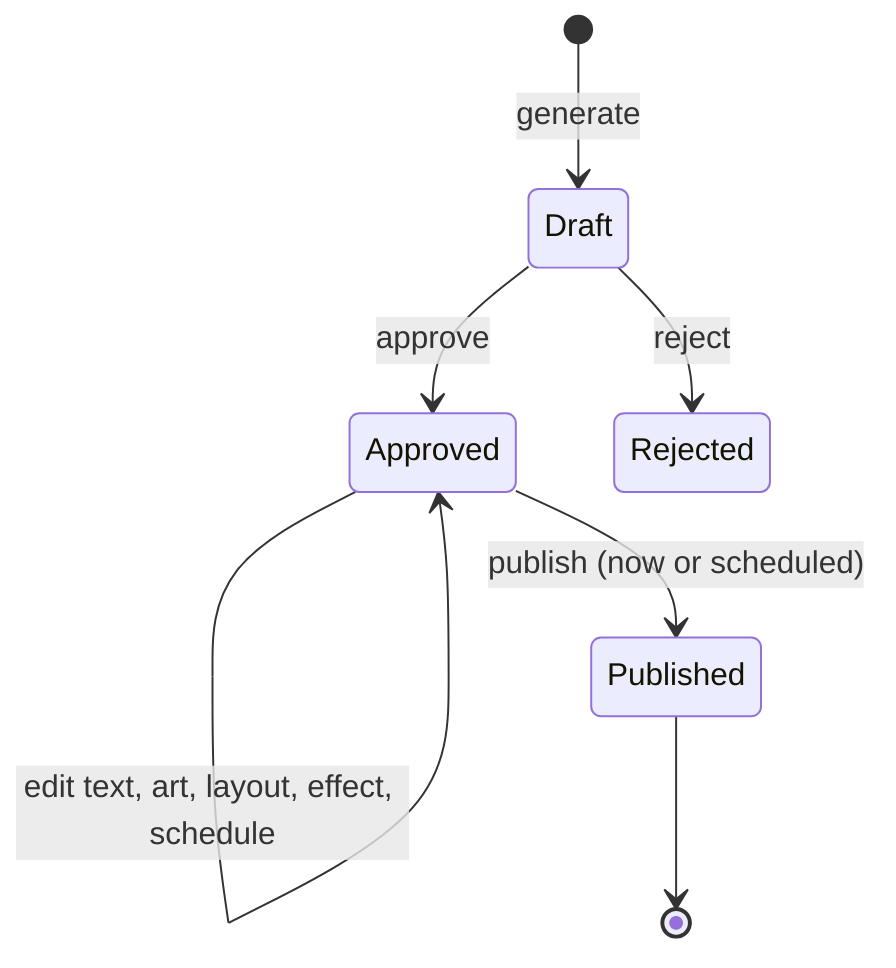

# System Architecture

## 1. Architecture constraints

- Python application, locally executable, solo-developer friendly.
- Modular monolith with modules and contracts at real change boundaries.
- Keep JSON and local text assets until requirements justify another storage
  mechanism.
- Avoid microservices, Kubernetes, event buses, distributed systems, and
  speculative plugin frameworks.
- Treat all unimplemented architecture below as planned, not shipped.

Status labels: **[CURRENT]** implemented; **[NEXT]** near-term design or
implementation; **[FUTURE]** longer-term capability.

## 2. Architecture diagrams

These diagrams render on GitHub (Mermaid) and describe the [CURRENT] system.

### 2.1 Components



### 2.2 One-image Reel lifecycle



### 2.3 Rendering: layout choice and video layers



### 2.4 Post status



Regenerate (from Draft or Rejected) creates a separate new Draft; the
original record is kept.

## 3. Current system (text view)

```text
CLI scripts/
   -> content_pipeline.py (optional category/subtype context)
      -> config_loader.py + YAML config/
      -> content_agent.py + prompts/
         -> ai_service.py (fixed Ollama-compatible endpoint/model)
      -> content_models.py validation
      -> comedy.yaml when Comedy is explicitly selected
   -> reel_storage.py + generated_reels/*.json

review CLI -> reel_storage.py -> generated_reels/*.json
storyboard CLI -> generated_reels/*.json -> generated_videos/*_storyboard.json
                                      -> generated_videos/*_scenes.txt
image prompt CLI -> storyboard + profile visual configuration
                   -> ai_service.py -> generated_images/*_image_prompts.txt
video prompt CLI -> reel + storyboard + image prompts + profile/format/platform config
                   -> generated_videos/*_master_prompt.txt
prepare_reel CLI -> runs storyboard, image-prompt, and master-prompt stages
single-page CLI -> content pipeline -> generated_posts/*.json
                                  -> generated_assets/*_design_prompt.txt
LinkedIn text CLI -> content pipeline -> generated_posts/*.json
                                        (no image-prompt asset)
local review UI -> draft generation, shared review decisions, and local history
               -> format-aware pipeline status and production-stage actions
               -> asset links for generated prompts and scene files

one-image Reel (image_reel format) and Instagram feed post:
  content pipeline (thinker rotation, story mode, critical lens, plain-English
                    rules, caption tidy, 5-hashtag cap, Threads fit)
                   -> generated_posts/*.json
  review UI text tools: Edit on-image text, Simplify, New wording
                   (content_agent.simplify_copy; nothing saved until Save)
  art_generator.py -> art prompt: wordless for overlay layouts, or the exact
                   words for illustrated story modes (designed_image)
  artwork (image or MP4/MOV clip, attached in the UI) -> generated_assets/
  media_renderer.py + templates/
      image_reel_poster.html | image_reel.html | feed_poster.html |
      quote_painting.html | designed.html
                   -> generated_assets/*_instagram.jpg (cover / feed image)
  video_renderer.py (ffmpeg): push-in + film finish + effect layer
      (sparks, meteors, rain, sunlight) + text fades + music_library.py
                   -> generated_assets/*_reel.mp4
  carousel format: media_renderer.render_carousel + templates/carousel_slide.html
                   -> one 1080x1350 JPEG per slide -> Instagram carousel
  review UI publish/schedule -> media_host.py (R2) -> instagram_publisher.py
                             -> facebook_publisher.py (Page: Reel, photo,
                                or multi-photo post; uploaded from this Mac)
  scripts/publish_scheduled.py (LaunchAgent, every minute): due posts,
      weekly token refresh, weekly iCloud backup (backup_content.py)
  analytics.py -> generated_assets/performance.json -> UI Performance section
```

### [CURRENT] Components and limits

- `scripts/` contains the canonical CLI commands.
- Root Python modules provide configuration models/loading, generation,
  prompt composition, JSON file operations, and model communication.
- YAML configures Critical Thinking / Rational Thoughts, Comedy, and QA Engineering & AI profiles;
  an optional Comedy category with ten subtypes; the buddha.realteachings and Life Is
  a Glitch brands with optional no-brand generation; Reel, single-page, and
  LinkedIn text-post formats; and
  Instagram and LinkedIn platform compatibility.
- The QA Engineering & AI profile can optionally select a profile-specific
  topic pillar; this guidance is separate from content categories and format
  contracts.
- Review is local and human-operated. Saved status values are Draft, Approved,
  and Rejected.
- The local browser UI supports review decisions for Reels and single-page
  posts; CLI review commands remain available for Reels.
- The browser UI derives production readiness from existing artifacts and
  records review/stage events in per-content JSONL history files.
- Storyboard preparation produces validated JSON plus a readable text export
  (multi-scene Reels; not the current focus).
- One-image Reels are rendered locally: Playwright renders the HTML layers
  and ffmpeg (bundled via imageio-ffmpeg) composes the MP4 and music.
- Publishing uses the Instagram API with Instagram Login; media is uploaded
  to Cloudflare R2 and deleted after Instagram fetches it. Credentials live in
  `.env` only. Saved statuses now include Published.
- A macOS LaunchAgent runs `scripts/publish_scheduled.py` every minute: it
  publishes due Reels and refreshes the long-lived token weekly.
- `analytics.py` reads per-post insights for posts made with the project.
- `ai_service.py` calls an Ollama-compatible endpoint; `MODEL_ENDPOINT` and
  `MODEL_NAME` in `.env` override the defaults. Do not claim a provider-neutral
  adapter exists yet. Image art is made by hand in an image tool or through
  the optional Gemini/Cloudflare image clients in `art_generator.py`.

## 4. Domain boundaries

```text
Source / Brief
    + Brand identity and defaults
    + Content Profile (editorial intent)
    + Format (output shape)
    + Platform (destination capabilities)
        -> Content Item
        -> Production Plan
        -> Media Asset (later)
```

- **Content Profile** owns audience, objective, voice, exclusions, and
  editorial/visual guidance. Examples: Comedy, Finance, Education.
- **Content Category** adds optional generation guidance across formats.
  Comedy is currently the only category and can specify one of ten subtypes.
  It does not replace the content profile or format.
- **Brand** owns optional publisher identity, reusable branding, voice
  overlays, and defaults. Example: buddha.realteachings.
- **Format** owns output fields and production constraints. Examples:
  Instagram Reel, YouTube Short, single-page graphic, LinkedIn text post,
  Thread, Blog Article.
- **Platform** owns destination capabilities and eventual publishing rules.
- **Source** is input material, not an editorial category.

Core code resolves validated context; it should not infer brand identity from
a profile or make profile-specific branches in the shared pipeline. An
explicit Comedy category with no brand argument defaults to Life Is a Glitch;
an explicit blank brand selection still means no publisher identity is
included or saved. Category metadata is stored only on opted-in drafts.

## 5. Target modular-monolith organization

The current flat root modules and `scripts/` are retained for now. Do not
perform a package move as part of video planning. Add modules incrementally
when contracts become concrete.

```text
config/
  brands/
  comedy.yaml                     # optional cross-format category guidance
  content_profiles/
  formats/
  platforms/
prompts/
  shared/
  content_profiles/
  formats/
scripts/                         # current CLI boundary
  main.py
  prepare_reel.py
  storyboard_generator.py        # timed/untimed storyboard JSON and text export
  ...
content_models.py                # current validated domain/config models
content_pipeline.py              # current generation orchestration
content_agent.py                 # current prompt assembly/model call
ai_service.py                    # current fixed model endpoint client
art_generator.py                 # art prompts, image clients, artwork storage
media_renderer.py                # HTML -> cover image (poster/panel layouts)
video_renderer.py                # ffmpeg Reel video (still or clip, music)
music_library.py                 # royalty-free track selection
instagram_publisher.py           # Instagram API (posts, Reels, insights)
media_host.py                    # Cloudflare R2 upload/delete
analytics.py                     # performance report
reel_storage.py                  # current local JSON operations
generated_reels/                 # current local JSON drafts
generated_posts/                 # current single-page post JSON drafts
generated_images/                # current image prompt text
generated_videos/                # storyboard JSON, scene export, master prompt
tests/
```

Possible future modules such as `storyboard_models.py`, `asset_catalog.py`,
`video_provider.py`, or `platform_adapters/` should be added only when the
corresponding roadmap phase begins. A practical modular monolith is preferable
to empty architectural layers.

## 6. Content pipeline status

| Pipeline stage | Status | Boundary / next decision |
|---|---|---|
| Brief/source | [CURRENT] | Text brief enters generation and is saved; structured source references are [NEXT]. |
| Brand/profile/format/platform resolution | [CURRENT] | YAML resolution exists; fuller profile/brand/format support is [NEXT]. |
| Content generation | [CURRENT] | Configured Reel, single-page, and LinkedIn fields are generated; Comedy guidance is opt-in and keeps those output contracts. |
| Human review | [CURRENT] | The local UI and CLI can review saved records; UI actions are recorded in local history. |
| Scene planning | [CURRENT] | Timed beats are parsed and untimed legacy scripts remain explicitly untimed; richer intent/continuity is [NEXT]. |
| Visual planning | [CURRENT] | Profile guidance informs image/master prompts; opted-in Comedy adds joke-driven framing, reactions, and timing guidance. |
| Storyboard | [CURRENT] | JSON records preserve timing, visual beats, narration/dialogue, sound, and camera notes; UI exposes the output and stage action. |
| Character/environment/camera/voice/music plans | [NEXT] | Start with optional plan fields/config; avoid assuming 3D. |
| Master video prompt | [CURRENT] | A composed text prompt is saved; registry/version provenance is [NEXT]. |
| One-image Reel render | [CURRENT] | Cover image and 8-second MP4 from a still or an attached clip, with music and film finish. |
| AI video generation (multi-scene) | [FUTURE] | Define only after storyboard and provider requirements are proven. |
| Publishing | [CURRENT] | Instagram (Reels and Feed) with approval, confirmation, scheduling, AI label, and text cover. Other platforms are [FUTURE]. |
| Analytics | [CURRENT] | Per-post insights linked to story mode, visual style, and thinker. |

## 7. Near-term design

### [NEXT] Structured production plan

Extend the current basic storyboard contract only as needed for reviewable
preparation:

- **ScenePlan:** ordered beats, source narration/dialogue, intended duration,
  and scene purpose.
- **StoryboardShot:** scene reference, visual action, composition, continuity
  references, and prompt text.
- **VisualPlan:** style, lighting, palette, aspect ratio, and constraints.
- **CharacterPlan / EnvironmentPlan:** optional identity and continuity
  descriptions; initially references/config, not a 3D asset database.
- **CameraPlan:** shot size, movement, and transitions as text fields.
- **AudioPlan:** voiceover and music direction; no voice/music rendering
  implied.
- **PromptRecord:** template ID/version, resolved context IDs, and rendered
  prompt text.

Keep future expanded outputs editable and reviewable. Preserve a path to current
`*_scenes.txt`, `*_image_prompts.txt`, and `*_master_prompt.txt` files during
contract migration.

### [NEXT] Prompt registry

Store reusable prompt templates as versioned text assets organized by shared
guidance, profile, format, and (when necessary) platform. A small YAML registry
can map stable IDs to files. Validate paths and required template values.
Record prompt IDs/versions on new production plans; do not claim existing
records have prompt provenance.

## 8. Video provider boundary

### [FUTURE] Provider-neutral contract

When rendered video is an active requirement, isolate provider differences
behind a small Python interface. The application supplies a normalized
request: storyboard/master prompt, aspect ratio, duration, optional asset
references, and generation settings. A provider adapter returns a normalized
result: status, output asset references, provider request metadata, and
explicit errors. Capture provider-specific IDs and usage details as optional
metadata without leaking them into domain rules.

Do not encode a vendor-specific prompt format into the content profile,
format, or storyboard contract. Add providers incrementally and test the
same request/result contract with mocks. Do not implement a generic provider
marketplace or plugin system before a second integration is justified.

## 9. Asset libraries and consistency

### [NEXT] Prompt and visual-style assets

Keep prompt versions and visual-style defaults in reviewable local config.
The content profile can reference visual guidance; brand configuration can
override reusable identity without changing the editorial profile.

### [FUTURE] Character, environment, voice, and music libraries

If recurring video production is validated, add local catalog records with
stable IDs, versioned descriptions/references, ownership, permission/rights
metadata, and links from each production plan. Libraries have distinct roles:

- **Character Library:** recurring character identity, appearance, behavior,
  voice reference, and approved source assets.
- **Environment Library:** reusable settings and continuity constraints.
- **Visual Style Library:** lighting, palette, materials, composition, and
  approved examples.
- **Voice Library:** voice identity, language/pronunciation, consent, and
  permitted use.
- **Music Library:** track/style reference, license, permitted channels, and
  attribution where required.

Brand-owned assets are not automatically reusable by another brand. Each
episode should record the exact asset and prompt versions used. This supports
character and scene consistency without promising perfect consistency from
any generation provider.

### [FUTURE] 3D animation

3D characters, recurring character consistency, consistent environments,
cinematic storytelling, educational storytelling, and comedy storytelling
are future capabilities. They may use provider-managed references or local
assets; the architecture should keep those details behind asset references
and provider adapters. No 3D renderer or consistency engine currently exists.

## 10. Configuration and precedence

Use validated YAML for human-authored settings and JSON for current content
records. Keep configuration data declarative. A future explicit precedence
can be: platform hard limits -> safety/rights policy -> brand identity ->
content profile -> format requirements -> request-level preferences.
Conflict resolution must be tested and explained; do not silently discard
constraints.

Secrets and provider credentials belong in environment variables or a
dedicated local secret mechanism, never in prompts or version-controlled
configuration.

## 11. Quality and failure behavior

- Validate configuration and generated fields at boundaries.
- Surface model, filesystem, and provider errors explicitly.
- Keep model and video generation calls bounded by timeouts.
- Never report a text prompt as a rendered media asset.
- Keep human approval ahead of publishing; live publishing needs explicit
  confirmation or a deliberate schedule, and failed scheduled posts are not
  retried automatically.
- Test legacy JSON reads, prompt context, configuration, and each contract
  with fixtures and mocked provider calls.
